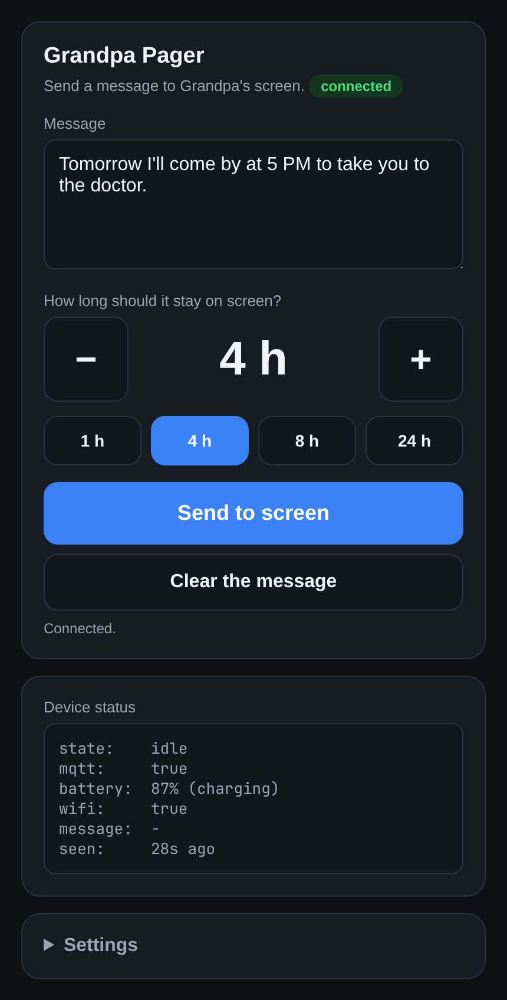
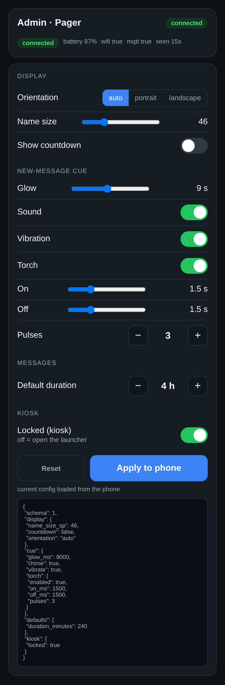
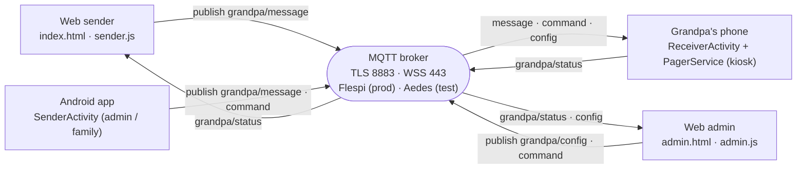

<div align="center">

# Grandpa Pager

**Turn any old Android phone into an always-on, locked-down message pager for an elderly relative.**

A static web sender, a token-gated admin console, and a custom Android app — all
talking over a **private MQTT broker**. No server to run, nothing to maintain.


</div>

Family sends a message from any browser in seconds; it appears **full-screen** in
large, high-contrast text, attributed to the sender, and clears itself when it
expires. Grandpa can't quit the app, change settings, or wander into other apps.
The phone reports its battery, Wi-Fi, link state and current message so you always
know it's healthy — and an admin can reconfigure it remotely without touching the
device.

## Features

- **Full-screen, high-contrast messages** with the sender's name, auto-sized to
  fill the screen.
- **Per-sender name colours**: every sender gets a stable colour from a palette
  that is guaranteed to contrast on the black screen, so you can tell who wrote
  at a glance (admin-configurable, falls back to one colour).
- **Localised**: the Android app and the web sender follow the system/browser
  language — English and Romanian are complete.
- **Automatic expiry** (default 4 h, per-message override) enforced *on the
  device* — never trusting broker retention.
- **Remote clear** and a non-blocking "a message is already showing" warning.
- **Attention cue** on a new message: a slow amber glow, a chime and a torch
  pulse (plus an optional double vibration, off by default).
- **Live diagnostics**: online/offline, battery + charging, Wi-Fi, MQTT, current
  message and how long ago it was last seen.
- **Admin console** (browser): text size, orientation, the received/expires time
  line, message auto-size bounds, colours, idle clock/date format, the arrival
  cue, the default duration, the status cadence (default 15 min), the idle
  screen-off toggle, the kiosk lock, and the device-owner hardening toggles.
- **Guarded remote reconfiguration**: change the broker and MQTT tuning from the
  console — the phone probes the candidate and **auto-reverts** within the window
  if it cannot connect, so a bad push can't strand it; and issue **restart /
  reboot** commands, all acknowledged in status.
- **Kiosk lockdown** via device-owner Lock Task Mode, re-armed on every boot,
  with a hidden admin escape gesture.
- **Power-aware**: the display sleeps when idle and wakes instantly on a new
  message (full-screen intent); the socket stays up on a wake/Wi-Fi lock. As
  device owner it also strips accounts, Bluetooth, location, printing, sync and
  mobile-network/tethering/roaming config.
- **Self-healing**: survives reboots, Wi-Fi loss and long broker outages
  (a 30 s reconnect watchdog).
- **Zero backend** and **MIT** licensed.

## Screenshots

<table>
<tr>
<td align="center" width="50%"><br><sub>Send a message</sub></td>
<td align="center" width="50%"><br><sub>Admin console</sub></td>
</tr>
<tr>
<td align="center" width="50%"><br><sub>Message on the phone</sub></td>
<td align="center" width="50%"><br><sub>Idle screen</sub></td>
</tr>
</table>

## How it works



Four topics carry everything:

| Topic | Direction | Purpose |
|---|---|---|
| `grandpa/message` | senders → phone | the latest message (retained; empty clears) |
| `grandpa/last` | senders → sender/admin | the last message, kept even after a clear (history) |
| `grandpa/command` | senders/admin → phone | `clear` · `set_connection` · `restart_app` · `reboot_device` |
| `grandpa/config` | admin → phone | versioned remote config (retained) |
| `grandpa/status` | phone → everyone | diagnostics + config acknowledgement |

The phone validates and clamps anything it receives, so a bad config is rejected
and never half-applied. Details in [`docs/architecture.md`](docs/architecture.md).

## User guide

### 1 · Send a message (family)

Open the sender page, type your name and the family token **once** (they stay in
your browser), then type the message, choose how long it should stay on screen,
and tap **Send to screen**. A banner warns if a message is already showing, and
the status panel mirrors the phone.

The connection pill is **end-to-end**: it reads *connected* only when **both** the
broker link is up **and** the phone's status is fresh; *phone offline* (amber) when
the broker is reachable but the phone is not (stale status), and *disconnected*
(red) when the broker itself cannot be reached.

Admins can skip the typing by handing out a one-tap **invitation link** with the
token (and the person's name) baked in:

```
https://<your-pages-site>/index.html#token=<family-token>&sender=Maria
```

The admin console takes one too (token only, no name):

```
https://<your-pages-site>/admin.html#token=<admin-token>
```

The token goes in the URL **fragment** (`#…`) on purpose: a fragment is never
sent to the server and never leaks in the `Referer` header. The page reads it,
saves it locally, strips it from the address bar and connects automatically. A
`?token=…` query string also works if you prefer, but the fragment is safer.
**Treat the link itself as the secret** — anyone who has it can send messages
(and, for the admin link, reconfigure the device).

### 2 · Configure the pager (admin)

Open **Admin** (the link at the bottom of the sender) and enter the admin token.
Tune the display, layout (sizes, colours, idle clock/date format), the
new-message cue, the default duration, the device-owner restrictions and the kiosk
lock, then **Apply to phone** — the phone validates, applies and confirms it back.

The same console also has a **guarded connection** section (change the broker and
MQTT tuning) and **device actions** (restart the app, reboot the phone). A broker
change is transactional: the phone probes the candidate and **auto-reverts** to the
last working connection within the revert window if it cannot connect, so a bad
push cannot strand the device. The password is never shown back.

### 3 · On Grandpa's phone

A new message fills the screen with the sender's name above it and fires the
attention cue. When it expires or is cleared the display goes back to sleep
(`power.screen_off_when_idle`); turn that off in the admin console to keep the
idle date-and-clock lit instead.

### 4 · Monitor &amp; control

The **Device status** panel shows `state` (`idle` / `showing` / `offline`), the
MQTT link, battery + charging, Wi-Fi, the message currently on screen (its text
and who sent it) and the last-seen age. **Clear the message** wipes the screen
remotely.

## Repository layout

```
index.html · sender.js         web sender      (GitHub Pages, MQTT.js over WSS)
admin.html · admin.js          web admin       (token-gated remote config)
mqtt.min.js · sw.js · manifest vendored lib + PWA shell + icons
android/                       Kotlin app (roles: receiver / admin / family)
  app/src/main/java/…          PagerService, MqttController, RemoteConfig, activities
  app/src/test/…               JVM unit tests
docs/                          architecture · decisions · runbook · flespi-setup · screenshots
tools/broker/                  local Aedes TLS/WSS broker (tests)
tools/scripts/                 e2e MQTT client + example prefs
.github/workflows/             CI (build + test) and tagged releases
.scratch/                      design maps, tickets and research (receiver · sender · admin)
```

## Quick start (developer)

```bash
# 1. local test broker (TLS + WSS)
cd tools/broker && npm install
setsid node server.js </dev/null >/tmp/broker.log 2>&1 &

# 2. build + install the app
cd ../../android && ANDROID_HOME=$HOME/Android/Sdk ./gradlew assembleDebug
S=$(adb devices | awk 'NR==2{print $1}')          # the connected phone
adb -s $S install -r app/build/outputs/apk/debug/app-debug.apk
adb -s $S reverse tcp:8883 tcp:8883                 # phone -> host broker over USB

# 3. configure it as the receiver, then send a message
cd ../tools && NODE_PATH=$PWD/broker/node_modules node scripts/mqtt.js send "Lunch is ready" 120 "Maria"
```

Full build/test/deploy/undo steps and a troubleshooting table are in
[`docs/runbook.md`](docs/runbook.md).

## Deploy to production

1. **Broker** — create a free [Flespi](https://flespi.com) account and mint three
   **scoped ACL tokens** (receiver, web sender, admin); never ship the Master
   token. Exact ACL JSON is in [`docs/flespi-setup.md`](docs/flespi-setup.md).
2. **Receiver** — configure the app on the phone with the receiver token
   (`mqtt.flespi.io:8883`, TLS), then lock it down:
   ```bash
   adb shell dpm set-device-owner com.grandpapager/.PagerDeviceAdminReceiver
   ```
3. **Web** — publish the repo to GitHub Pages. Family open the sender, admins
   open `…/admin.html`; both connect over `wss://mqtt.flespi.io:443`.
4. **Power &amp; longevity** — grant the battery-optimization exemption (offered
   in setup) and enable *Stay awake*. Because the phone runs plugged in 24/7,
   keep it near 70% charge with the bundled
   [`tools/scripts/charge-controller.js`](tools/scripts/charge-controller.js)
   (drives a smart plug from the `grandpa/status` battery readings) — full
   physical/thermal/network hardening in
   [`docs/device-hardening.md`](docs/device-hardening.md).

## Security

- **TLS only**; the bundled test CA is trusted in debug builds only, and the
  socket factory forces HTTPS endpoint identification.
- **Least-privilege tokens**: receiver, sender and admin each get their own
  per-topic ACL token, origin-locked for the browser ones. The Master token never
  leaves your PC.
- **Hardened web pages**: strict Content-Security-Policy on the sender *and* the
  admin console, no third-party scripts (MQTT.js is vendored), admin token kept
  in `localStorage`.
- **Invitation links** carry a sender token in the URL. The fragment form is
  preferred (not sent to the server, not in `Referer`); the page strips the
  params from history on load, and the service worker no longer caches URLs that
  carry a query string. A leaked invite link is a leaked sender token — recreate
  the token to revoke it.
- **Kiosk**: device-owner Lock Task Mode; remote config can only toggle the lock
  — never credentials or device-owner status.

Full audit and residual risks: [`SECURITY.md`](SECURITY.md).

## Documentation

- [`docs/architecture.md`](docs/architecture.md) — components, topics, payloads, remote config.
- [`docs/decisions.md`](docs/decisions.md) — why each choice was made.
- [`docs/runbook.md`](docs/runbook.md) — build, test, deploy, undo, troubleshooting.
- [`docs/flespi-setup.md`](docs/flespi-setup.md) — broker and token setup.
- [`docs/device-hardening.md`](docs/device-hardening.md) — 24/7 battery, thermal, fire, OS and network hardening (with a manual checklist).
- [`.scratch/`](.scratch/) — the wayfinder maps, tickets and research.

## Releases

Push a `v*` tag and GitHub Actions builds `app-release.apk` and attaches it to a
Release. It signs with the debug key by default; set the `KEYSTORE_B64` /
`KEYSTORE_PASSWORD` / `KEY_ALIAS` / `KEY_PASSWORD` repo secrets (or a local
`android/keystore.properties`) for a real key. Every push and PR runs the CI
workflow (debug build + unit tests).

## License

[MIT](LICENSE) © Catalin Bivolaru
