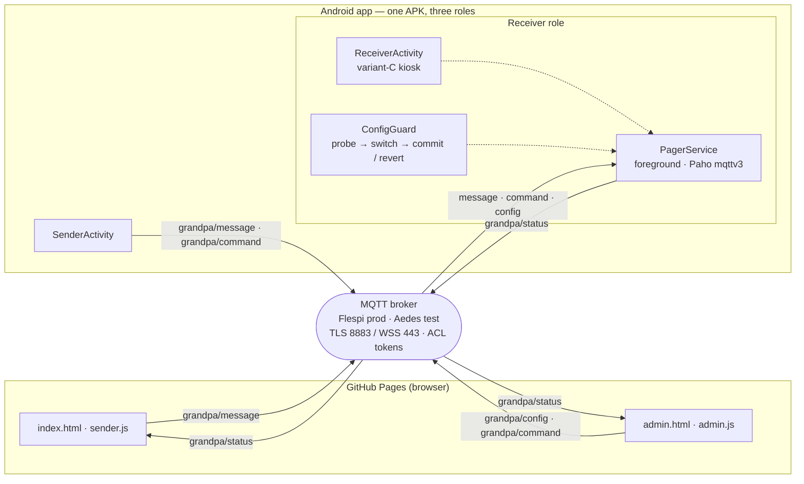
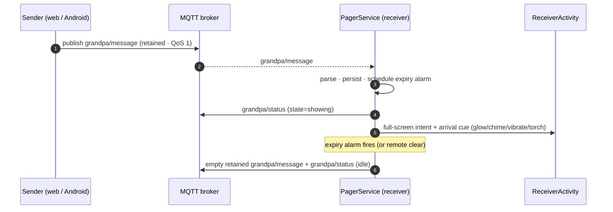

# Architecture — Grandpa Pager

A custom Android MQTT pager plus a zero-backend static web client. One Kotlin
codebase, one APK, three roles chosen at setup. Senders publish full-screen,
sender-attributed, auto-expiring messages; the receiver (Grandpa's phone)
displays them, enforces expiry locally, and publishes diagnostics. Admins tune
the device remotely over MQTT. No Home Assistant, no server.

## Components



Foreground `PagerService` owns the MQTT connection in every Android role. The
Eclipse **Paho `mqttv3`** client runs on a single-thread executor; the UI is
notified through the in-process `PagerBus` and by re-reading `SharedPreferences`.

### Modules

| File | Responsibility |
|---|---|
| `PagerCore.kt` | Pure logic: topics, roles, payloads, ISO time, expiry, JSON, change bus. No Android UI — unit-tested on the JVM. |
| `Config.kt` | SharedPreferences config + persisted receiver state (message and remote config). |
| `RemoteConfig.kt` | Remote-config model (`RemoteConfig`) + defensive codec (`RemoteConfigCodec`): parse, clamp, reject bad schema. |
| `ConnectionConfig.kt` | Broker connection model (host/credentials + MQTT tuning) and its clamping codec. Secret is device setup, never retained config. |
| `ConfigGuard.kt` | Pure guardrail state machine for a remote connection change: probe → switch → commit, or auto-revert within the window; survives reboot. |
| `TlsUtil.kt` | TLS socket factory = platform trust anchors (+ bundled test CA **in debug only**), wrapped for Paho's no-arg socket and HTTPS endpoint identification. |
| `MqttController.kt` | Paho wrapper: TLS, persistent session, auto-reconnect, subscribe, publish. |
| `PagerService.kt` | Foreground service: connect, receive, show/clear, apply remote config, expiry alarm, watchdog, diagnostics. |
| `ReceiverActivity.kt` | Variant-C display: sender centred above the message (auto-sized), and below it a `Received … , expires …` time line (hidden unless `display.countdown`); idle = one-row date + clock (1.3×) or a sleeping display; one-shot glow+chime+vibration+torch cue; kiosk entry; admin exit gesture; applies remote config. |
| `DateLabels.kt` | Locale-aware idle labels: `SATURDAY 10/10/2026` and the device time format. |
| `SenderActivity.kt` | Android compose + monitor UI. |
| `SetupActivity.kt` | Role + broker configuration (+ battery-optimization request). |
| `BootReceiver.kt` | Restart service after reboot / update. |
| `DeviceOwnerManager.kt` | Device-owner kiosk: lock task, persistent home, status bar. |
| `index.html` / `sender.js` | GitHub Pages sender (MQTT.js over WSS). |
| `admin.html` / `admin.js` | GitHub Pages admin console (token-gated remote config; live receiver preview, invite link + QR, bilingual EN/RO). |
| `common.js` | Shared browser helpers (i18n locale, escape, invite parsing, status freshness). |
| `qrcode-generator.js` | Vendored MIT QR encoder (offline, no CDN) for the admin invite QR. |

## Topics

| Topic | Retain | QoS | Direction | Purpose |
|---|---|---|---|---|
| `grandpa/message` | yes | 1 | senders → receiver | Latest message (empty payload clears). |
| `grandpa/last` | yes | 1 | senders → sender/admin | Message history: a versioned array of the last N messages, newest first. A clear empties `grandpa/message` but never touches this, so history survives. |
| `grandpa/command` | no | 1 | senders/admin → receiver | `{"action":"clear"}` · `set_connection` · `restart_app` · `reboot_device`. |
| `grandpa/config` | yes | 1 | admin → receiver | Versioned remote config (see below). |
| `grandpa/status` | yes | 1 | receiver → senders/admin | Diagnostics + config ack. |

There is **no MQTT Last Will**: Flespi rejects a CONNECT carrying a Will for a
scoped (ACL) token. Offline is detected by **status staleness**.

`grandpa/last` is a retained **history** topic: the **web sender is its writer**
(the Android app neither publishes nor subscribes to it — it is a private web
contract, so the payload shape can evolve without an app update). It mirrors
every message observed on `grandpa/message` into a capped, newest-first array,
so the last N messages survive a clear (which empties only `grandpa/message`) and
any sender/admin can read them. The payload is
`{"v":1,"messages":[{id,sender,text,created_at,expires_at,duration_minutes}, …]}`;
a legacy single-object payload is still accepted. The cap is
`defaults.history_count` (see below). The web sender shows the newest message
with a link that scrolls to a full history section; the admin console shows the
same read-only (its token has no publish on `grandpa/last`).

The sender **adopts the retained array before writing** (a fresh page must not
clobber the broker's copy with its own partial view), dedupes by `id`, and only
republishes when the array actually changed — so the retained echo of its own
write cannot start a publish loop.

## Payloads

Message — `grandpa/message`:

```json
{
  "id": "8f2c…-uuid",
  "sender": "Maria",
  "text": "Lunch is ready",
  "created_at": "2026-10-10T14:54:45Z",
  "expires_at": "2026-10-10T16:54:45Z",
  "duration_minutes": 120
}
```

`sender` is **mandatory** and rendered as the yellow name line.

Diagnostics — `grandpa/status`:

```json
{
  "state": "showing | idle | offline",
  "sender": "Maria", "text": "Lunch is ready",
  "battery": 68, "charging": true, "battery_temp_c": 34.5,
  "wifi": true, "mqtt": true,
  "current_message_id": "8f2c…", "expires_at": "2026-10-10T16:54:45Z",
  "last_seen": "2026-10-10T14:54:45Z", "app": "receiver",
  "config": { "schema": 1, "…": "the effective remote config (echo)" },
  "config_applied_at": "2026-10-10T14:54:45Z", "config_error": null,
  "device_owner": true,
  "connection": { "state": "active", "host": "mqtt.flespi.io", "port": 8883,
                  "use_tls": true, "password_set": true, "last_error": null },
  "command": { "last": "restart_app", "received_at": "…", "result": "ok" }
}
```

`sender` and `text` are the current message (both `null` when idle), so the web
sender and admin console — which subscribe to `status` — can show what is on the
screen and who sent it, without needing read access to `grandpa/message`.

The `connection` object reports the **guardrail state** (`active | probing | switched
| committed | reverted | failed`) and whether a password is set — **never the
password itself**. `command` echoes the last device-control command and its result.

`battery_temp_c` is the battery temperature in °C (`null` if unknown). For a
device that is powered on permanently it is the best early-warning signal for a
degrading cell; `tools/scripts/charge-controller.js` can also gate a smart plug
on it. See [`device-hardening.md`](device-hardening.md).

Remote config — `grandpa/config` (v1):

```json
{ "schema": 1, "updated_at": "2026-10-10T14:54:45Z",
  "display": { "name_size_sp": 58, "countdown": false, "orientation": "auto",
               "message_size_min_sp": 10, "message_size_max_sp": 64,
               "name_color": "#FFFAB005", "per_sender_colors": true,
               "message_color": "#FFFFFFFF",
               "warn_color": "#FFFFB300", "countdown_color": "#FF9E9E9E",
               "idle_clock_scale": 1.3, "idle_date_format": "auto", "warn_text": null },
  "cue": { "glow_ms": 9000, "chime": true, "vibrate": false,
           "torch": { "enabled": true, "on_ms": 1500, "off_ms": 1500, "pulses": 3 } },
  "defaults": { "duration_minutes": 240, "history_count": 10 },
  "telemetry": { "interval_minutes": 15 },
  "power": { "screen_off_when_idle": true },
  "kiosk": { "locked": true },
  "device_owner": { "lock_task": true, "status_bar_disabled": true,
                    "restrict_accounts": true, "restrict_bluetooth": true,
                    "restrict_location": true, "restrict_printing": true,
                    "restrict_sync": true, "restrict_mobile_networks": true,
                    "restrict_tethering": true, "restrict_roaming": true } }
```

The receiver **clamps** numerics to bounds and **ignores** unknown/wrong-type
fields; a `schema` other than `1` rejects the whole config (error acked in
`status.config_error`). Bounds: `name_size_sp` 20–120; `message_size_min/max_sp`
8–200 (min collapses to max if it exceeds it); `glow_ms` 0–20000; torch
`on_ms`/`off_ms` 200–5000; `pulses` 1–10; `duration_minutes` 5–1440;
`interval_minutes` 1–1440; `idle_clock_scale` 1.0–3.0. Colours must be
`#AARRGGBB` (invalid falls back to the default); `idle_date_format` is one of
`auto | dmy | mdy | ymd`; `warn_text: null` keeps the localized string. It persists
the accepted config, re-applies it on every (re)connect and reboot, and **echoes
the effective config** in `status.config` so the admin UI prefills. Adding an
optional field under `schema: 1` is backward-compatible (old receivers ignore it
and default it).

`defaults.history_count` (1–50) is exactly such a field: the receiver ignores it,
but the admin publishes it in `grandpa/config`, and the **web sender subscribes
to `grandpa/config`** to read it — so the same count reaches every sender device,
not just the admin's browser. (This is the one sender-side ACL addition:
`subscribe grandpa/config`, issued as a separate SUBSCRIBE so a missing grant
cannot affect the other subscriptions; without it the sender falls back to a
default of 10.) The receiver does not echo the field because it drops unknown
config keys, so `status.config` and the admin's `localStorage.gp_history_count`
mirror are only fallbacks. Resolution order: `grandpa/config` → `status.config`
→ localStorage → 10.

`display.per_sender_colors` (default `true`) gives each sender a stable colour
from a 15-colour palette whose every entry clears WCAG **AAA** contrast
(>= 7:1) on the black background. A sender is assigned a colour the first time
they appear — preferring their hashed slot, probing forward past colours other
senders already own — and the assignment is **persisted**, so distinct senders
get distinct colours (up to 15) and a sender always keeps the same one.
`display.name_color` is the fallback when the toggle is off or the name is blank.

The `device_owner` block drives the reversible hardening restrictions when the app
is device owner (see below); each toggle adds **or clears** its restriction, in
both directions (so relaxing takes effect too, and `restrict_bluetooth` turns the
radio back on). The receiver reports `status.device_owner` so the console can show
whether the toggles can act.

## Message flow



## Remote connection change (guarded)

Changing the broker (host/port/TLS/credentials) or the MQTT tuning (keepalive,
timeout, auto-reconnect, QoS, max inflight) is **not** part of the retained config:
it carries a secret and must be transactional. It travels as a command:

```json
{ "action": "set_connection",
  "candidate": { "host": "mqtt.example.com", "port": 8883, "use_tls": true,
                 "username": "…", "password": "…",
                 "keepalive_s": 30, "connect_timeout_s": 15,
                 "auto_reconnect": true, "qos": 1, "max_inflight": 20 },
  "revert_after_s": 90, "confirm_after_s": 15 }
```

The receiver runs a pure `ConfigGuard` state machine:

1. **Request** → persist the current connection as the backup, record the window.
2. **Probe** the candidate (only when the endpoint host/port/TLS actually moves —
   a credential-only change is validated by the switch itself), then **switch**.
3. A stable connection for `confirm_after_s` → **commit** (clear the backup).
4. No connection within `revert_after_s`, or a failed probe → **revert** to the
   backup and reconnect.

The pending state is persisted, so a reboot resumes the timer; an unconfirmed
change reverts. A wrong broker therefore cannot strand the phone. The password is
stored only as device setup and is never echoed — status reports `password_set`
only.

## Device-control commands

`restart_app` restarts the foreground `PagerService` (scheduled re-start, then
`stopSelf()`) and brings `ReceiverActivity` back; `reboot_device` reboots via the
device-owner `DevicePolicyManager.reboot()` and reports `not device owner` when it
cannot. Both are acknowledged in `status.command`.


## Expiry model (application-level)

The receiver never trusts broker TTL.

1. On `showMessage`, `expires_at` is parsed and persisted (epoch millis).
2. An `AlarmManager.setExactAndAllowWhileIdle` alarm is set for `expires_at`.
3. A one-second UI ticker refreshes the `Received … , expires …` line from the
   wall clock, and a safety net clears the message if the alarm was missed.
4. On expiry the receiver clears local state, publishes an empty **retained**
   message to `grandpa/message`, and re-publishes `idle` status.
5. On reboot the service restores the persisted message; if already expired it
   clears instead of redisplaying.
6. **Late arrival.** A message that arrives *already expired* is normally dropped,
   but a never-seen message that expired within the last 10 minutes is shown once,
   re-dated to a 60 s window — so a brief offline blip cannot make a just-sent
   message vanish. Older messages are dropped.

Default duration is **240 minutes**, overridable per message (sender) or per
device via `defaults.duration_minutes` (admin).

## Power & wake

- **Idle screen-off.** When no message is active and `power.screen_off_when_idle`
  is set, `ReceiverActivity` clears `FLAG_KEEP_SCREEN_ON` and puts the display to
  sleep with `DevicePolicyManager.lockNow()` (device owner); the idle clock is not
  shown. If the app is not device owner it falls back to the idle clock rather
  than risk a stuck black screen.
- **Guaranteed wake.** `PagerService` keeps the socket alive with a
  `PARTIAL_WAKE_LOCK` + `WifiLock(WIFI_MODE_FULL_HIGH_PERF)` for its lifetime.
  On `showMessage` it posts a **full-screen-intent** notification on a dedicated
  `IMPORTANCE_HIGH` channel (`pager_alert`); the system turns the screen on and
  brings `ReceiverActivity` forward, which is marked `showWhenLocked` /
  `turnScreenOn`. The notification is cancelled on clear/expiry. This was
  verified on the Mi A1: the display goes `Dozing` when idle and wakes on a new
  message.
- **Status cadence.** Diagnostics are published every
  `telemetry.interval_minutes` (default 15) plus immediately on
  connect/show/clear/config-apply. The cadence is deliberately **decoupled** from
  the reconnect watchdog — the MQTT keepalive, not the status publish, keeps the
  socket up, so a slow cadence does not delay reconnection.
- **Device hardening.** As device owner the app applies a reversible set of
  `UserManager` restrictions (accounts, Bluetooth, location, printing,
  mobile-network config, tethering, roaming) and disables master sync, driven by
  the `device_owner` remote-config block; see
  [`device-hardening.md`](device-hardening.md). Each toggle adds or clears its
  restriction. Cleared by the release gesture.

## Reliability

- `cleanSession=false` + stable clientId → persistent session; queued QoS1
  messages survive brief disconnects.
- Paho `automaticReconnect` **plus a 30 s watchdog** for both roles that
  recreates the client if the link is dead (Paho's auto-reconnect can give up
  after a long outage). Status publishing runs on its own timer (above).
- `BootReceiver` restarts the service on `BOOT_COMPLETED` / app update.
- Foreground service (low-importance, ongoing notification) resists being killed;
  battery-optimization exemption requested at setup.
- Echo-loop guard: an empty retained clear is republished only when a message was
  actually held, and never in response to receiving an empty clear.
- **Client reachability.** The web sender and admin console show *connected* only
  when **both** the MQTT link is up **and** the receiver's status is fresh. A
  broker-up-but-phone-stale link reads *phone offline* (amber); no broker link
  reads *disconnected* (red). So "connected" always means a message can actually
  reach the phone.

## Security

- **TLS only** (`ssl://`, port 8883). `TlsUtil` trusts the platform CAs; the
  bundled test CA is trusted **only in debug builds**. The socket factory is
  wrapped to implement Paho's no-arg `createSocket()` and to request **HTTPS
  endpoint identification**.
- **Scoped ACL tokens** per role (receiver, web sender, admin) — never the
  Master token on any client. The browser tokens are origin-locked to the Pages
  site; the receiver token is usable only from a native client.
- The **web sender** and the **admin console** both ship a strict
  **Content-Security-Policy** (no inline event handlers) and load no third-party
  scripts (MQTT.js is vendored). The **admin token** is kept in `localStorage`
  (so the console stays signed in across restarts).
- Lockdown: device-owner lock task removes the power menu, status bar and
  recents; persistent home re-arms the app at boot. The **retained config** cannot
  change the broker/credentials or device-owner status. Broker/credential changes
  are only possible as a **guarded `set_connection` command** (probe + bounded
  auto-revert, password never echoed); the device owner is never removed remotely.
- No production secrets are committed; see [`../SECURITY.md`](../SECURITY.md).

## Known limitations / caveats

- **Hostname verification**: Paho connects via the no-arg socket, so endpoint
  identification may have no hostname to check; the primary protection is
  trusting only public CAs (never the test CA in release).
- **Free-tier risk**: Flespi's free tier is labelled "testing & development";
  keep the broker swappable (host/port/user/pass are runtime config).
- **Factory reset** via stock recovery (vol+power) wipes the device regardless of
  device owner — an accepted physical-escape risk.
- **EOL device** — Android 9 (Mi A1) no longer receives security patches; a
  permanently internet-connected receiver is therefore contained (dedicated
  VLAN/SSID) rather than patched. See [`device-hardening.md`](device-hardening.md).
- **Sender identity is not authenticated** — the `sender` name is typed; anyone
  holding a token can claim any name (adequate for a family, not identity).
- **Family onboarding / remote OTA** are not yet specified.
